# 🎮 Awesome-RTS-Game-Remastering-Modding

  

  
  
  
  
  
  
  

## 🚀 Top RTS Game Remastering & Modding Ecosystem

**Curated Developer Directory of SaaS Platforms, Hosted Multiplayer Lobbies & Open-Source RTS Engines**  
*Comprehensive resource for classic Real-Time Strategy engine reimplementations, source-port remasters, multiplayer netplay matchmakers, community mod loaders, and graphics wrappers (Direct3D 11, Vulkan, DirectDraw).*

**Last updated: November 2026** 📅

---

## 📖 Overview

This repository tracks notable **SaaS/hosted multiplayer & modding platforms** and **open-source GitHub projects** for **RTS Game Remastering & Modding**. These tools preserve, modernize, and extend classic Real-Time Strategy (RTS) titles—bringing 64-bit Direct3D 11 / Vulkan rendering, cross-platform Linux/macOS support, enhanced skirmish AI, rollback/lockstep netcode, and mod loaders to iconic games like *Command & Conquer*, *Age of Empires*, *StarCraft*, *Warcraft*, *Total Annihilation*, *Supreme Commander*, and *Dune*. ⚔️

Whether you are looking for community multiplayer matchmaking services, official source-port releases under GPLv3, complete game engine rewrites in C++ or C#, or graphics translation wrappers for vintage Windows 95/98 games, this list categorizes the best tools in the ecosystem. 🛠️

---

## 📑 Table of Contents

- [📊 Sector Overview & Market Dynamics](#-sector-overview--market-dynamics)
- [☁️ SaaS & Hosted Multiplayer Platforms](#️-saas--hosted-multiplayer-platforms)
- [💻 Open-Source RTS Engines & Source Ports](#-open-source-rts-engines--source-ports)
- [🧩 Frameworks & Modding Utilities Summary](#-frameworks--modding-utilities-summary)
- [🤝 How to Contribute](#-how-to-contribute)
- [💖 Support](#-support)
- [📈 Star History](#-star-history)
- [⚖️ Disclaimer & Licensing](#️-disclaimer--licensing)

---

## 📊 Sector Overview & Market Dynamics

The global PC strategy and RTS gaming market is estimated at **$8.2 billion in 2026**, driven by an active resurgence in competitive nostalgia, high-definition remasters, and user-generated content (UGC). 📈

The platform and distribution segment is **highly concentrated** (winner-take-all) around dominant PC store fronts and publisher launchers (Valve's Steam and Microsoft/Blizzard's Battle.net), while the community matchmaking and modding landscape remains **moderately fragmented** into passion-driven niche federations (e.g., CnCNet for Westwood titles, FA Forever for Supreme Commander, Voobly for legacy Age of Empires). 🌐

---

## ☁️ SaaS & Hosted Multiplayer Platforms

The following hosted services and platforms provide commercial game distribution, mod hosting, NAT traversal, low-latency netplay streaming, or dedicated community matchmaking lobbies. 🕹️

*Table sorted in descending order by parent company valuation / annual revenue:* 🏢

| Platform | Parent Company / Operator | Valuation / Annual Revenue | Starting Tier Pricing | Free Tier Limit | Highlights & RTS Capabilities |
| :--- | :--- | :--- | :--- | :--- | :--- |
| **[Battle.net](https://blizzard.com)** | 🏢 Microsoft / Activision Blizzard | **$3.1 Trillion** (Microsoft Market Cap) | $19.99 one-time (e.g. StarCraft: Remastered base game purchase) | Free account forever; unmetered access to StarCraft II: Wings of Liberty campaign, custom arcade maps & unranked co-op commander mode up to level 5 | Proprietary master matchmaking and patch distribution network powering StarCraft: Remastered, StarCraft II, and Warcraft III: Reforged custom maps. |
| **[Steamworks & Steam Remote Play](https://steampowered.com)** | 🏢 Valve Corporation | **$8.5 Billion** (Est. Annual Revenue) / ~$16B Valuation | $100.00 one-time Steam Direct app submission deposit per published game | Free account forever; 0-cost Steam Remote Play Together multiplayer streaming for remote friends; unlimited Workshop mod downloads and subscriptions | Valve's PC gaming platform, mod distribution (Steam Workshop), and peer-to-peer game streaming allowing remote friends to play split-screen/local LAN RTS titles over the internet. |
| **[GOG Galaxy](https://gog.com)** | 🏢 CD Projekt Group | **$2.8 Billion** (Market Cap) | $5.99 one-time (typical catalog price for retro RTS titles) | Free account forever; cloud saves, manual offline installer downloads, and rollback game versioning without mandatory client runtime | DRM-free digital distribution platform with optional cloud saves, rollback versioning, and multiplayer matchmaking for classic PC strategy titles. |
| **[Parsec Cloud & Gaming](https://parsec.app)** | 🏢 Unity Technologies / Parsec | **$7.5 Billion** (Unity Market Cap) | $8.00 / user / month (Parsec Warp tier) | Free forever plan; 1 active ultra-low latency 60 FPS P2P desktop session with up to 4 simultaneous guest controllers / keyboard inputs | Ultra-low-latency desktop and interactive game streaming platform widely used for retro RTS local-LAN netplay sessions with remote players. |
| **[Mod DB](https://www.moddb.com/)** | 🏢 DBolical Pty Ltd | **$12 Million** (Est. Valuation) | $5.00 / month (Mod DB Supporter / Ad-Free subscription tier) | Free forever plan; unlimited mod uploads, version downloads, community mod hosting, forum participation, and public news showcases | The web's largest dedicated modding database for total conversions, engine patches, custom maps, and indie RTS remaster releases. |
| **[GameRanger](https://gameranger.com)** | 🏢 Scott Kevill / GameRanger Pty Ltd | **$3.5 Million** (Est. Valuation) | $19.95 / year (GameRanger Silver Tier) | Free forever plan; basic chat lobbies, NAT traversal, and peer-to-peer matchmaking for over 700 legacy PC/Mac RTS games | Long-running matchmaking and NAT-traversal lobby service keeping alive classic RTS titles whose official master servers were permanently retired. |
| **[Voobly](https://voobly.com)** | 🌐 Voobly Community Network | **$2.0 Million** (Est. Valuation) | $5.00 / month (Voobly Bronze Membership tier) | Free forever plan; standard matchmaking rooms, peer-to-peer multiplayer lobbies, anti-cheat detection, and basic ladder tracking | Veteran peer-to-peer multiplayer client and ladder platform hosting Age of Empires II, Age of Mythology, and Rise of Nations mods and competitive tournaments. |
| **[CnCNet](https://cncnet.org)** | 🌐 CnCNet Open Community | **Non-Profit / Community-Funded** (Open Collective ~$15K/yr) | $0.00 / month (100% Free / Voluntary Open Collective donations) | Free forever plan; completely unmetered custom match hosting, peer-to-peer tunnel server routing, and integrated auto-updater | Dedicated community-run multiplayer lobby and patched client network keeping Command & Conquer (Tiberian Dawn, Red Alert, Tiberian Sun, Yuri's Revenge) active online. |
| **[FA Forever (Forged Alliance Forever)](https://faforever.com)** | 🌐 FAF Community Association | **Non-Profit / Community-Funded** (Patreon ~$25K/yr) | $0.00 / month (100% Free / Voluntary Patreon sponsorships) | Free forever plan; unmetered ranked matchmaking, automated map & mod vault synchronization, replay streaming, and patch distribution | Community-operated tournament matchmaker, replay vault, custom balance patcher, and mod manager for Supreme Commander: Forged Alliance. |

---

## 💻 Open-Source RTS Engines & Source Ports

Active open-source RTS engine reimplementations, original RTS titles, EA source-code ports, graphics wrappers, and mod loaders. ⚡

*Table sorted in descending order by GitHub stargazers count:* ⭐

| Repository | GitHub_Stars | Primary Language | Highlights & Modernization Capabilities |
| :--- | :--- | :--- | :--- |
| **[OpenRA](https://github.com/OpenRA/OpenRA)** |  | C# | Modular, cross-platform RTS engine modernizing classic Westwood games (*Tiberian Dawn*, *Red Alert*, *Dune 2000*) with replay viewers, dedicated server lobbies, modern UI, and customizable YAML traits. |
| **[openage](https://github.com/SFTtech/openage)** |  | C++ / Python | Open-source cross-platform engine clone of the classic Genie Engine designed to run original *Age of Empires II* game assets with modern rendering, pathfinding, and Python scripting. |
| **[CnC_Red_Alert (EA Official)](https://github.com/electronicarts/CnC_Red_Alert)** |  | C++ | Official GPLv3 release by Electronic Arts of the original Command & Conquer: Red Alert source code, providing the baseline for source ports, modern bug fixes, and mod DLL development. |
| **[CorsixTH](https://github.com/CorsixTH/CorsixTH)** |  | C++ / Lua | Open-source reimplementation of the classic management/simulation strategy engine *Theme Hospital*, featuring high-resolution rendering, custom campaigns, and cross-platform builds. |
| **[CnC_Generals_Zero_Hour (EA Official)](https://github.com/electronicarts/CnC_Generals_Zero_Hour)** |  | C++ | Official GPLv3 source code release by Electronic Arts for Command & Conquer: Generals and Zero Hour, unleashing 64-bit community ports, AI enhancements, and engine bug patching. |
| **[Beyond All Reason](https://github.com/beyond-all-reason/Beyond-All-Reason)** |  | Lua / C++ | Next-generation open-source RTS inspired by *Total Annihilation*, featuring massive battles with tens of thousands of individual physical units, realistic terrain deformation, and competitive matchmaking. |
| **[Warzone 2100](https://github.com/Warzone2100/warzone2100)** |  | C++ / C | Iconic 3D post-nuclear real-time strategy and tech-tree warfare game continuously modernized with Vulkan/OpenGL renderers, cross-platform netplay, and modular unit chassis research. |
| **[Spring Engine](https://github.com/spring/spring)** |  | C++ | Flagship 3D open-source RTS game engine with realistic projectile physics, extensive Lua API scripting, and total-conversion compatibility for massive multi-faction wars. |
| **[fheroes2](https://github.com/ihhub/fheroes2)** |  | C++ | Free, open-source multiplatform reimplementation of the *Heroes of Might and Magic II* game engine with rewritten AI, 4K rendering, gamepads, and QoL interface improvements. |
| **[cnc-ddraw](https://github.com/FunkyFr3sh/cnc-ddraw)** |  | C | DirectDraw API recreation using Direct3D 9, OpenGL, and GDI to enable borderless windowed mode, integer scaling, shader upscaling, and Alt-Tab crash prevention for 90s/2000s RTS games. |
| **[Widelands](https://github.com/widelands/widelands)** |  | C++ | Open-source economy, road network, and warfare real-time strategy game inspired by *The Settlers II*, featuring multiple distinct tribes, single-player campaigns, and internet multiplayer. |
| **[0 A.D.](https://github.com/0ad/0ad)** |  | C++ / JS | Free, open-source historical RTS and 3D Pyrogenesis engine depicting ancient civilizations with custom naval combat, tactical formations, and the Atlas scenario editor. |
| **[OpenXcom](https://github.com/OpenXcom/OpenXcom)** |  | C++ | Modern open-source reimplementation of the classic UFO: Enemy Unknown strategy game with extensive modding support, resolution scaling, and tactical bug fixes. |
| **[Augustus (Caesar III)](https://github.com/Keriew/augustus)** |  | C | Enhanced open-source source-port of *Caesar III* featuring modern roadblocks, roadblocks, storage limits, new monuments, high-res UI, and zoom support. |
| **[OpenLoco](https://github.com/OpenLoco/OpenLoco)** |  | C++ | Open-source reverse-engineered C++ reimplementation of Chris Sawyer's *Locomotion*, bringing high-definition displays, multi-platform builds, and clean architecture. |
| **[OpenDUNE](https://github.com/OpenDUNE/OpenDUNE)** |  | C | Clean-room open-source recreation of *Dune II*, the foundational real-time strategy game, allowing modern platforms to run original game data files natively. |
| **[Freeciv](https://github.com/freeciv/freeciv)** |  | C | Open-source empire-building strategy game with real-time multiplayer support, customizable rulesets, web client support, and competitive international diplomacy. |
| **[OpenRA - Red Alert 2](https://github.com/OpenRA/ra2)** |  | C# | Official OpenRA mod implementing Command & Conquer: Red Alert 2 mechanics, featuring voxel rendering, Prism tank weapon logic, and Yuri mind-control mechanics on modern operating systems. |
| **[OpenHV](https://github.com/OpenHV/OpenHV)** |  | C# | Standalone retro pixel-art science-fiction real-time strategy game powered by the OpenRA engine, released with 100% free and open-source creative commons game assets. |
| **[Zero-K](https://github.com/ZeroK-RTS/Zero-K)** |  | C++ / Lua | Fast-paced open-source RTS on the Spring engine featuring dynamic terraforming, manual physics-based aiming, over 100 balanced units, and competitive ladder play. |
| **[Stratagus](https://github.com/Wargus/stratagus)** |  | C++ / C | Versatile 2D real-time strategy gaming engine capable of powering customizable medieval and fantasy strategy games, including Warcraft II data extractions via Wargus. |
| **[Recoil Engine](https://github.com/beyond-all-reason/RecoilEngine)** |  | C++ | High-performance multi-threaded fork of the Spring RTS engine powering Beyond All Reason, with modern Vulkan rendering, lockstep netcode, and massive simulation scale. |
| **[Thyme](https://github.com/TheAssemblyArmada/Thyme)** |  | C++ | Clean-room modern C++ reimplementation of the SAGE engine that powers *Command & Conquer: Generals* and *Zero Hour*, prioritizing memory safety and multiplatform execution. |
| **[Vanilla-Conquer](https://github.com/TheAssemblyArmada/Vanilla-Conquer)** |  | C++ / C | Portable, cross-platform source port built directly from EA's released source code for Tiberian Dawn and Red Alert with SDL2 audio/video and modern platform support. |
| **[Wargus](https://github.com/Wargus/wargus)** |  | C++ / Lua | Importer and compatibility scripts allowing users to play *Warcraft II: Tides of Darkness* and *Beyond the Dark Portal* legally on the open-source Stratagus engine. |
| **[MegaGlest](https://github.com/MegaGlest/megaglest-source)** |  | C++ | Cross-platform 3D real-time strategy engine supporting up to 7 distinct playable factions, XML-driven unit configuration, and integrated LAN/Internet multiplayer matchmaking. |
| **[CnCGeneralsZH-Reforged](https://github.com/olcayseygan/CnCGeneralsZH-Reforged)** |  | C++ | Zero Hour rebuilt from EA's source code: 64-bit architecture, Direct3D 11 rendering pipeline, CMake/VS2022 build system, base-building AI restoration, and ~60 engine bug fixes. |
| **[Wyrmsun](https://github.com/Andrettin/Wyrmsun)** |  | C++ / Lua | Open-source strategy game based on Germanic mythology and history built upon the Stratagus engine, featuring custom civilizations, retro pixel art, and quest dialogues. |
| **[Combined Arms (CAmod)](https://github.com/Inq8/CAmod)** |  | C# | High-profile total conversion mod running on the OpenRA engine bringing together classic Command & Conquer factions (GDI, Nod, Allies, Soviets, Scrin) into an expansive crossover RTS. |
| **[Chronoshift](https://github.com/TheAssemblyArmada/Chronoshift)** |  | C++ | Modern open-source cross-platform reimplementation of *Command & Conquer: Red Alert* in C++, focusing on exact game-logic preservation without requiring legacy Windows compatibility modes. |
| **[GenLauncher](https://github.com/p0ls3r/GenLauncher)** |  | C# | Essential mod manager and auto-updater for Command & Conquer: Generals Zero Hour, enabling one-click installation, mod switching, resolution fixes, and multiplayer compatibility. |

---

## 🧩 Frameworks & Modding Utilities Summary

- **Want to build a standalone modern RTS or Total Conversion?** 🛠️
  - Choose **[OpenRA](https://github.com/OpenRA/OpenRA)** for 2D/2.5D isometric gameplay with proven rollback and multiplayer lobbies.
  - Choose **[Beyond All Reason / Recoil Engine](https://github.com/beyond-all-reason/Beyond-All-Reason)** or **[Spring Engine](https://github.com/spring/spring)** for true 3D environments, physics simulations, and massive unit counts.
  - Choose **[0 A.D.](https://github.com/0ad/0ad)** for historical simulation RTS with complex citizen-soldier mechanics and integrated map editing.

- **Want to run classic 90s/2000s strategy games on Windows 11, macOS, or Linux?** 🖥️
  - Use **[cnc-ddraw](https://github.com/FunkyFr3sh/cnc-ddraw)** for instant DirectDraw/DirectX compatibility, windowed scaling, and crash fixes.
  - Use **[CnCNet](https://cncnet.org)** or **[GameRanger](https://gameranger.com)** to play online through community tunnel servers.
  - Use **[Vanilla-Conquer](https://github.com/TheAssemblyArmada/Vanilla-Conquer)** or **[CnCGeneralsZH-Reforged](https://github.com/olcayseygan/CnCGeneralsZH-Reforged)** for native 64-bit and Direct3D 11 compilation.

---

## 🤝 How to Contribute

1. Fork this repository. 🍴
2. Add your entry in alphabetical or categorized order matching the table format above. 📝
3. Verify that all URLs, Stars_Badge parameters, and descriptions are accurate and non-promotional. 🔍
4. Open a Pull Request detailing the changes and reason for addition. 🚀

---

## 💖 Support

Thank you for exploring this curated repository! If you find this project valuable for your modding journeys, engine development, or RTS nostalgia, please consider supporting us:

- ⭐ **Star this repository** to help others discover it on GitHub!
- 🍴 **Fork and contribute** your favorite modern RTS engine projects and modding tools.
- 📢 **Share with fellow strategists** across Reddit, Discord, and Mod DB communities.
- ☕ **Buy us a coffee** and support ongoing maintenance via the [GitHub Sponsor Dashboard](https://github.com/sponsors/ishandutta2007).

---

##  Star History

---

## ⚖️ Disclaimer & Licensing

- This is a community-curated list compiled for educational, preservation, and modding research purposes. 📜
- Most engine reimplementations (e.g. *OpenRA*, *Vanilla-Conquer*, *OpenAge*, *OpenDUNE*) do not distribute copyrighted proprietary art, music, or campaign assets; players must provide legally purchased original game archives (`.mix`, `.big`, `.drs`, `.wad`). 🔒
- Electronic Arts, Westwood Studios, Blizzard Entertainment, Microsoft, and other brand names are trademarks of their respective owners. 🏷️
